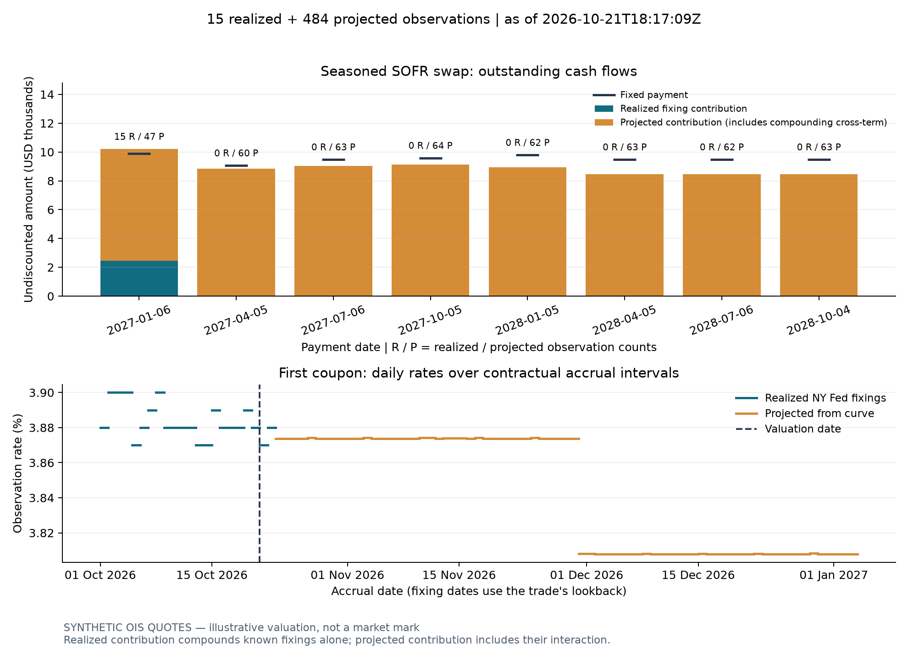
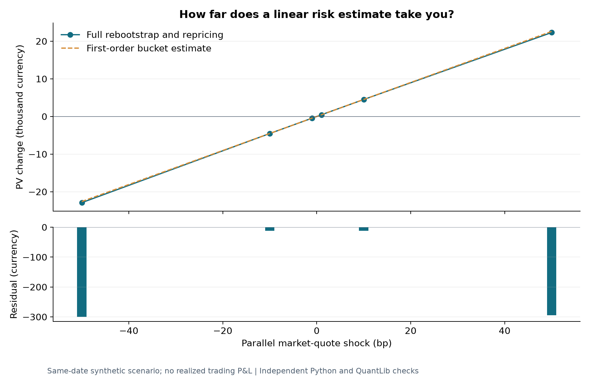

# rates-engine-cpp

A C++20 interest-rate curve, swap valuation and risk library, checked against an
independent Python implementation and QuantLib. Version 2.2 prices **seasoned
SOFR swaps with realized fixings**, observation conventions and separate discount
and projection curves, including fully recalibrated two-curve market-quote risk.
[Model boundaries](docs/limitations.md) are explicit.

## Start with a seasoned SOFR swap (v2.2)

At **21 October 2026, 18:17:09 UTC**, the captured example values a **USD 1 million
payer, 3.75% fixed**, running from 1 October 2026 to 1 October 2028. Quarterly
coupons use two-day lookback, observation shift and two-day payment lag.

| Output | Value |
| --- | ---: |
| Dirty PV | **−4,448.43 USD** |
| Signed accrued | 144.94 USD |
| Clean PV | **−4,593.36 USD** |
| Daily observations | **15 realized / 484 projected** |

**Actual captured NY Fed fixings + synthetic OIS quotes.** These are illustrative
valuations, not market-calibrated marks. Missing required history is rejected.

After building the [Python bindings](docs/reproducibility.md#bindings):

```sh
python python/run_sofr_valuation.py --module-dir build/release --manifest data/sofr/manifest.json --out results/sofr-demo
python python/validate_sofr.py --module-dir build/release --out results/sofr-validation --require-quantlib
```



The [lifecycle guide](docs/sofr-lifecycle.md) explains the cash flows, quote-risk
API and auditable inputs. [Expanded validation](docs/sofr-validation.md) covers
30,524 independent comparisons, including unusual stubs, distinct calendars and
full two-curve quote recalibration. Basis-swap calibration, clearing and collateral
lifecycle processing remain outside scope.

The original example below takes eight synthetic quotes through calibration,
cash flows, PV and two risk coordinates.

## Build and price one swap

Requires CMake 3.25+, Ninja, a C++20 compiler and Python 3.10+. GoogleTest 1.17.0
is fetched on the first test build. On Windows use an x64 Visual Studio Developer
shell or the [portable toolchain](docs/reproducibility.md), and append `.exe` to
executable names.

```sh
cmake --preset release
cmake --build --preset release --parallel 4
ctest --preset release
./build/release/rates_cli --quotes examples/synthetic_quotes.csv --swap examples/sample_swap.csv --out results/demo
```

At **2 January 2025**, the [inputs](examples/synthetic_quotes.csv) contain
1M/3M/6M deposits and 1Y/2Y/3Y/5Y/10Y par swaps, in decimal rate units.
The [trade](examples/sample_swap.csv) pays **3.7% fixed** on **1,000,000 notional**
until **2 January 2030**, receiving quarterly floating payments. Fixed payments
are semiannual with 30E/360 accrual; floating/deposit accrual is ACT/360.
The example uses weekend-only modified-following adjustment and one curve for
both projection and discounting.

| Output | Value |
| --- | ---: |
| Fixed-leg PV | 167,660.057351 |
| Floating-leg PV | 172,191.410251 |
| Payer PV | **4,531.352900** |
| Par fixed rate | **3.800000%** |
| Signed parallel quote DV01 | **−451.944300 currency/bp** |

The market par rate exceeds the contractual coupon, so the payer has a positive
PV. The engine reprices every input within a `1e-12` decimal-rate tolerance,
then interpolates log discount factors. [Recorded outputs](docs/results/demo)
include the calibrated curve, residuals, cash flows, summary and risk.


## Read the risk correctly

Risk uses **`(PV_down − PV_up) / (2 × bump_bps)`**. A negative number for this
payer means PV rises when rates rise. A +1 bp move predicts about **+451.94**
of PV change before nonlinear effects.

Quote buckets bump one market quote and rebuild the curve. Zero-node buckets
bump one continuous node yield directly. They answer different questions:


The CLI writes `curve.csv`, `calibration.csv`, `cashflows.csv`, `summary.csv`
and `risk.csv`. Risk maturity identifies the **actual calibrated pillar**:
adjusted for deposit/swap contracts, exact for continuous-zero observations.
See [risk definitions](docs/risk_methodology.md) and [conventions](docs/conventions.md).

## Move the quotes and explain the PV change

```sh
python -m pip install QuantLib
python python/generate_case_study.py --cli build/release/rates_cli --out results/case-study --require-quantlib
```

A **+10 bp parallel shock** changes PV by **+4,507.58** after recalibration.
The first-order bucket estimate is **+4,519.44**, leaving a **−11.86** residual.
At +50 bp the residual grows to **−294.32**. All seven scenarios, including a
steepener, pass independent Python and QuantLib quote-helper checks. These are
same-date hypothetical PV changes, not realized trading P&L.



The [model-validation case study](docs/model-validation-case-study.md) gives
hypotheses, tolerances and results. [Charts](docs/charts) include PNG and SVG
exports, input hashes and a [reproduction script](python/generate_charts.py).

## Validate and extend the example

```sh
python -m pip install QuantLib pybind11
python python/validate_results.py --cli build/release/rates_cli --output results/validation --require-quantlib
python python/validate_conventions.py --cli build/release/rates_cli --output results/conventions --require-quantlib
cmake --preset release -DRATES_BUILD_PYTHON=ON -Dpybind11_DIR="$(python -m pybind11 --cmakedir)"
cmake --build --preset release --parallel 4
python python/validate_multicurve.py --module-dir build/release --out results/multicurve --require-quantlib
```

The original numerical suite has **1,285 comparisons**. Convention validation
includes independent rate-helper calibration. The OIS/multi-curve suite adds
**230 comparisons** for positive/negative rates, explicit holidays, cash flows
and discount/forwarding quote risk. See the [v2.1 verification record](docs/launch-validation.md)
for measured checks, coverage and platform boundaries.

The [SOFR/OIS and multi-curve guide](docs/multicurve.md) documents:

- `compound_sofr`: ACT/360 compounding with weekend/holiday accrual.
- `OisCurveBootstrapper` and `price_ois`: annual compounded overnight swaps.
- `build_forward` and `price(discount, projection, swap)`: separate curves.
- `multi_curve_risk`: full recalibration for discount and forwarding quote shocks.

For seasoned SOFR trades, use the new `SofrSwap`, `FixingStore`,
`SofrCurveBootstrapper` and `price_sofr` APIs. The
[SOFR lifecycle and market-data guide](docs/sofr-lifecycle.md) documents the
cash-flow conventions, imported quote schema and remaining boundaries.
The original `price_ois` and CLI/replay interfaces retain their earlier scope.

```sh
python python/run_sofr_valuation.py --module-dir build/release --manifest data/sofr/manifest.json --out results/sofr-demo
python python/validate_sofr.py --module-dir build/release --out results/sofr-validation --require-quantlib
python python/test_sofr_replay.py --module-dir build/release --out results/sofr-replay --require-quantlib
```

This example combines **actual captured NY Fed fixings with explicitly synthetic
OIS quotes**. It values a seasoned 1m payer at **−4,448.43** dirty PV and
**−4,593.36** clean PV, with 15 realized and 484 forecast daily observations.
The expanded lifecycle suite passes **30,524** independent comparisons; real-fixing replay
adds **40** cash-flow and dual-curve node/quote-risk comparisons. See the
[v2.2 verification record](docs/sofr-validation.md).

## Explore the rest of the library

| Area | Entry point |
| --- | --- |
| Historical curves | [249 Fed curves and 24,900 trade valuations](docs/real-historical-data.md) |
| Portfolio aggregation and shared scenarios | [v2 design and scaling measurements](docs/v2.md) |
| Mathematics | [Methodology](docs/methodology.md), [validation](docs/mathematical_validation.md) |
| Performance | [Benchmarks](docs/benchmarks.md), [coverage](docs/coverage.md) |
| Builds, bindings, static analysis and sanitizers | [Reproducibility](docs/reproducibility.md) |
| Installed C++ library | [Consumer example](examples/consumer), [architecture](docs/architecture.md) |
| Batch operations | [Runbook](ops/runbook.md) |
| Separate ETF simulator | [Retrospective TLT demonstration](docs/trading-simulation.md) |

Fed data are fitted Treasury estimates from a downloaded vintage, used as a
proxy for hypothetical swaps. Original publication times are unavailable.
Public NY Fed fixing capture is available; executable OIS quotes require an
external provider and the validated import interface. No options, XVA or
production-readiness claim.
MIT licensed; dependencies retain their own licenses.
