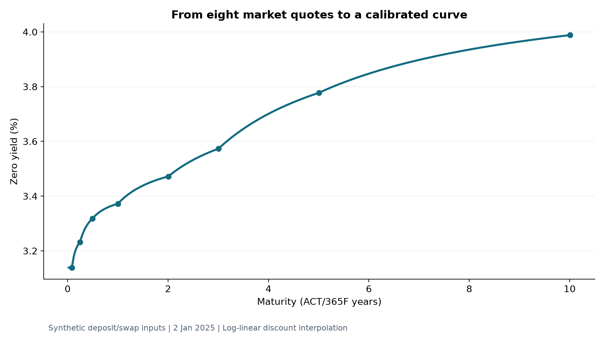
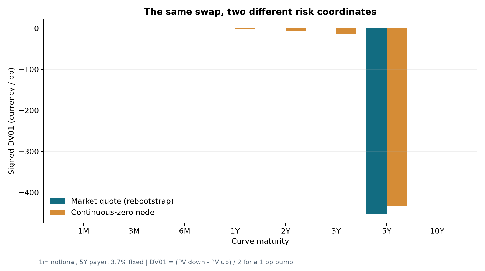

# rates-engine-cpp

[](https://github.com/Aniket2002/rates-engine-cpp/actions/workflows/ci.yml)
[](https://github.com/Aniket2002/rates-engine-cpp/releases/tag/v2.3.0)

A **C++20 interest-rate derivatives engine** for curve calibration, swap valuation,
market-quote risk, portfolio replay, and contractual lifecycle accounting.
It supports OIS discounting, separate projection curves, seasoned SOFR swaps,
and same-currency overnight basis swaps, with optional Python bindings and
independent Python/QuantLib validation.

The repository connects numerical pricing to practical workflows: importing and
checking market inputs, producing cash flows and sensitivities, sizing hedges,
replaying historical snapshots, and reconciling payments and cash collateral.
Research studies examine curve-model uncertainty and the limits of hedging.

**Source:** 2.4.0-dev, unreleased. **Published download:** v2.3.0.
The newer solver, curve ambiguity workflow, and subsequent fixes are available
in source; they are absent from that release. See the [changelog](CHANGELOG.md).

[Quick start](#quick-start) · [Interfaces and workflows](#interfaces-and-workflows) ·
[Validation](#validation) · [Documentation](docs/README.md) · [Contributing](CONTRIBUTING.md)

## What the engine covers

| Area | Implemented behavior | Guide |
| --- | --- | --- |
| Dates and conventions | Gregorian dates, explicit holiday calendars, business-day adjustment, month-end handling, short final stubs, ACT/360, ACT/365F and 30E/360 accrual | [Conventions](docs/conventions.md) |
| Curve construction | Deposit/par-swap bootstrapping and direct continuous-zero inputs; OIS discounting; separate projection calibration; SOFR and basis calibrators; log-linear discount interpolation and quote-repricing diagnostics | [Methodology](docs/methodology.md), [multi-curve pricing](docs/multicurve.md) |
| Swap valuation | Fixed/floating swaps, future OIS, seasoned SOFR and compounded overnight/overnight basis swaps; cash flows, PV, par rates/spreads, and SOFR/basis clean/dirty PV with accrued amounts | [SOFR lifecycle](docs/sofr-lifecycle.md), [basis swaps](docs/basis-clearing-collateral.md) |
| Risk and portfolios | Parallel and bucketed quote DV01 through full rebootstrap, separate zero-node sensitivities, downstream curve recalibration, shared single-curve portfolio scenarios and explicit per-trade failures | [Risk methodology](docs/risk_methodology.md), [portfolio design](docs/v2.md) |
| Market data and replay | Availability-aware fixing revisions, captured NY Fed SOFR data, validated OIS quote imports, timestamped quote lookup, freshness checks, and synthetic/Fed Treasury-proxy replay | [Market-data status](docs/market-data-status.md), [historical data](docs/real-historical-data.md) |
| Clearing and collateral | In-memory acceptance, rejection, payment and termination events; cash-collateral calls, transfers, interest and return; contractual basis-payment reconciliation and optional SQLite journals | [Lifecycle and persistence](docs/durable-lifecycle.md) |
| Hedging and research | Bounded, lot-rounded SOFR hedge sizing; nonlinear stress scenarios; quote-compatible curve bounds, exported witness curves and conditional additional-quote ranking | [Hedge study](docs/hedging-study.md), [curve ambiguity](docs/curve-ambiguity-research.md) |

## How the components fit together

Quotes, calendars and conventions define the calibration instruments. The
bootstrappers produce discount and projection curves; pricing combines those
curves with trade schedules and, for seasoned overnight coupons, available
fixings. Risk calculations perturb market quotes and repeat calibration and
valuation. Portfolio calculations reuse calibrated scenarios across trades.

Lifecycle components track a different part of the workflow: which contractual
payments are due, which have settled, and how cash collateral changes. The basis
contract adapter connects priced, fully realized coupons to those obligations;
the optional SQLite layer persists and replays the validated event journals.

The native library owns the financial calculations. Command-line tools handle
CSV input and exports, while Python provides data adapters, persistence,
research orchestration and independent reference implementations.

| Calibrated curve | Quote risk versus zero-node risk |
| --- | --- |
|  |  |

These plots use the introductory synthetic single-curve example.
[Inputs and reproduction](docs/worked-examples.md#build-and-price-one-swap) and
[chart provenance](docs/charts/manifest.json) are retained.

## Quick start

Run source commands from the repository root. Builds use CMake 3.25+, Ninja,
a C++20 compiler and Python 3.10+. See the
[toolchain setup](docs/reproducibility.md) for compiler installation and Windows
Developer shells.

### Build the current source

On Windows, with the compiler and CMake available:

```powershell
python -m venv .venv
.\.venv\Scripts\python.exe -m pip install ninja pybind11 QuantLib "scipy>=1.14,<2"
.\run.ps1 -WithPython -Test
```

The launcher builds Release, runs CTest and prices the sample swap.
Use `-Configuration Debug` for Debug.

On Linux/macOS:

```sh
python3 -m venv .venv
. .venv/bin/activate
python -m pip install ninja pybind11 QuantLib "scipy>=1.14,<2"
cmake --preset release -DRATES_BUILD_PYTHON=ON -Dpybind11_DIR="$(python -m pybind11 --cmakedir)" -DPython3_EXECUTABLE="$(python -c 'import sys; print(sys.executable)')"
cmake --build --preset release --parallel 4
ctest --preset release
./build/release/rates_cli --quotes examples/synthetic_quotes.csv --swap examples/sample_swap.csv --out results/demo
```

GoogleTest is fetched on the first test build if it is not installed. The
Python-enabled suite needs pybind11, QuantLib and SciPy; Matplotlib is needed
only to regenerate charts. Bindings are optional: use `RATES_BUILD_PYTHON=OFF`
for native tools. With tests and bindings disabled, the native library needs
neither Python nor GoogleTest.

### Try the published Windows binaries

Extract the [v2.3.0 Windows x64 ZIP](https://github.com/Aniket2002/rates-engine-cpp/releases/tag/v2.3.0),
open PowerShell in the extracted root, and run:

```powershell
.\bin\rates_cli.exe --quotes examples/synthetic_quotes.csv --swap examples/sample_swap.csv --out results/demo
```

For this synthetic 1 million notional, 5Y payer at 3.7% fixed, expect approximately
**4,531.35 PV**, **3.80% par rate**, and **-451.94 currency/bp signed parallel
quote DV01**. Both source and packaged demos write summary, curve, calibration,
cash-flow and risk CSVs under `results/demo`.

The ZIP contains native tools and a static C++ library, with Windows compiler
runtimes embedded. Python extensions must be built for the chosen interpreter.
[Package verification](docs/results/runtime/release-verification.json) records
the published download and extracted-binary checks.

## Interfaces and workflows

| Interface | Purpose |
| --- | --- |
| `rates::rates_engine` | Installed CMake target for the C++ library; public headers are in `include/rates` |
| `pyrates` | Optional pybind11 module exposing native pricing, risk, SOFR, basis, lifecycle and ambiguity APIs |
| `rates_cli` | One single-curve swap with configurable conventions and detailed CSV exports |
| `rates_batch` | Single-curve portfolio valuation and timestamped replay, including stale-data and partial-failure reporting |
| `rates_simulate` | A separate single-instrument ETF long/cash simulation experiment |
| Python workflow scripts | Captured-fixing valuation, hedge studies, contractual lifecycle persistence, historical replay and curve ambiguity |

The CSV tools retain their single-curve scope. Use the C++ or Python APIs for
separate discount/projection curves and the richer SOFR/basis conventions.

After building bindings, these commands run the main Python demonstrations:

```sh
python python/run_sofr_valuation.py --module-dir build/release --manifest data/sofr/manifest.json --out results/sofr
python python/hedge_study.py --module-dir build/release --out results/hedging --require-quantlib
python python/run_basis_lifecycle.py --module-dir build/release --out results/lifecycle --database results/lifecycle.sqlite
python python/curve_ambiguity.py --module-dir build/release --input examples/curve-ambiguity.json --out results/ambiguity --require-quantlib
```

Use the active environment's Python; on Windows the equivalent is
`.\.venv\Scripts\python.exe`. The examples above create `results/` before the
SQLite command. The [replay runbook](ops/runbook.md) covers `rates_batch`,
snapshot selection and exit statuses. For C++ consumers, use
`find_package(rates_engine CONFIG REQUIRED)` and link `rates::rates_engine`;
the [consumer example](examples/consumer) demonstrates installation and usage.

## Pricing and risk methodology

**Curve construction.** Curves store positive discount factors and interpolate
their logarithms between pillars. Instantaneous forwards are consequently
piecewise constant, with jumps at pillars. Extrapolation is rejected.
Vanilla/OIS calibration uses safeguarded secant steps with bisection fallback;
seasoned SOFR and basis calibration retain bisection. Calibrated instruments
must pass quote-residual checks.

**Multiple curves.** Discount factors value future payments; projection curves
generate floating rates. A discount-quote shock rebuilds discounting and
recalibrates projection to unchanged forwarding quotes. Basis risk extends this
dependency chain through the other overnight projection curve.

**Seasoned SOFR.** Coupon valuation combines realized fixings and projected daily
rates, with lookback, observation shift, lockout, and spot/payment lags. Fixings
are selected by availability at the valuation timestamp. Missing required past
fixings fail explicitly. Accrued amounts and payment-date inclusion have
documented conventions.

**Risk coordinates.** Quote risk bumps market inputs and rebuilds curves;
zero-node risk shifts continuous node yields directly. Signed DV01 is
`(PV_down - PV_up) / (2 * bump_bps)`, in currency per basis point. Thus a
negative DV01 for a payer means its PV rises when rates rise.

**Portfolio execution.** The single-curve portfolio path shares base/shocked
curves and equal-date/convention schedules. Invalid trades are reported
individually; aggregates cover successful trades only. Benchmarks measure this
scenario-reuse design and calibration costs on stated workloads.

## Data, lifecycle and reproducibility

The SOFR adapter captures public NY Fed fixings and archives snapshots with
hashes. OIS quote imports check schema, units, timestamps, freshness, required
tenors and convention compatibility. These checks do not supply an executable
quote feed. The captured SOFR demonstration combines real fixings with
**synthetic OIS quotes**.

Historical replay supports immutable timestamped quote files and explicit
as-of/freshness policies. The Fed GSW dataset contains fitted Treasury zero
curves used as a retrospective valuation proxy; it is not an executable swap
market or a point-in-time strategy backtest.

Clearing and collateral ledgers validate events before committing state and
support idempotent replay. The contractual basis workflow checks the complete
payment inventory and amounts before normal-maturity closure. SQLite journals
add atomic batches, rollback and serialized concurrent writers on local disk.
These are generic modeled rules, without a live clearinghouse connection.

[Worked examples](docs/worked-examples.md) retain inputs, valuation dates and
expected outputs. [Recorded results](docs/results) and their manifests identify
specific configurations and revisions; generated local output goes in ignored
`build/` and `results/` directories.

## Demonstrations and research

| Workflow | Recorded example | Details |
| --- | --- | --- |
| Multi-curve valuation | Synthetic 1 million, 5Y, 3.5% payer: PV 28,509.36 with separate projection, versus -16,545.34 using the discount curve in both roles | [Inputs, conventions and comparison](docs/multicurve.md) |
| Seasoned SOFR | Captured 21 October 2026 example: dirty PV -4,448.43 USD, clean PV -4,593.36 USD; 15 realized and 484 projected observations | [Cash-flow chart](docs/charts/sofr-cashflows.png), [reproduction](docs/worked-examples.md#seasoned-sofr-swap) |
| Constrained hedging | Synthetic 5Y SOFR swap hedged with 2Y/4Y/6Y swaps: quote-risk norm reduced by 51.68%; some stress outcomes worsen | [Hedge chart](docs/charts/hedging.png), [study and assumptions](docs/hedging-study.md) |
| Curve ambiguity | Synthetic 1 million, 3.5Y payer: baseline PV 2,720.35; admissible PV range -66,244.31 to 63,956.10 with assumed forwards between -1% and 10% | [Witness-curve chart](docs/results/curve-ambiguity/curve-ambiguity.png), [research and prior art](docs/curve-ambiguity-research.md) |

The ambiguity workflow solves LPs over discount factors, exports witness curves,
and checks numerical optimality and independent QuantLib repricing. Its ranges
are conditional on quote intervals and forward assumptions, not confidence
intervals or forecasts. Admissible-curve bounds have prior art; no new
mathematical theory or global novelty is claimed.

Performance work includes [portfolio scenario reuse](docs/v2.md),
[Linux profiling](docs/v2.md#linux-replay-and-profiling-evidence), and the
[bootstrap solver study](docs/solver-review.md). Measurements identify hardware
and workloads; no QuantLib performance comparison is claimed. The
[ETF simulator](docs/trading-simulation.md) is a separate supporting experiment.

## Validation

GoogleTest exercises native invariants and failure paths. Python checks CLI,
bindings, replay and journal behavior; independent Python and QuantLib
implementations compare prices, cash flows, calibrations and quote risk.
CI defines Linux GCC/Clang, Windows MSVC and macOS builds, plus sanitizer,
formatting/static-analysis and coverage jobs.

| Recorded scope | Result | Evidence |
| --- | --- | --- |
| Published v2.3.0 Windows Release, bindings enabled | 100/100 CTest entries passed | [Runtime verification](docs/results/runtime/verification.json) |
| Published v2.3.0 commit, cross-platform CI | 7/7 jobs passed | [CI record](docs/results/ci-v2.3.0.json) |
| Independent OIS/separate-projection suite | 230/230 comparisons passed | [Report](docs/results/multicurve/report.json) |
| Expanded SOFR lifecycle and two-curve quote risk | 30,524/30,524 comparisons passed | [Methods and tolerances](docs/sofr-validation.md) |
| Expanded ambiguity audit, 2.4.0-dev | 28 witnesses repriced; 154 QuantLib comparisons passed, including all sweeps | [Consistency verification](docs/results/curve-ambiguity/consistency-verification.json) |

These counts describe different suites and revisions. The badge shows current
main-branch CI; historical records do not certify later changes.
[Coverage](docs/coverage.md) documents its C++-library denominator, the basis
coverage gap and LLVM profile warnings. CLI, bindings and Python are excluded
from that denominator. Tests and comparisons cover the documented cases and
tolerances, not every possible convention combination.

## Repository guide

| Path | Contents |
| --- | --- |
| [include/rates](include/rates), [src](src) | Public C++ APIs and native implementations |
| [apps](apps) | Pricing, batch-replay and simulation executables |
| [python](python) | Bindings, adapters, workflows, reference pricers and validation scripts |
| [tests](tests), [benchmarks](benchmarks) | Native tests and measured performance workloads |
| [examples](examples), [data](data) | Synthetic trades/quotes, consumer project and captured data with provenance |
| [docs](docs/README.md), [ops](ops/runbook.md) | Methods, worked examples, research, validation evidence and replay operations |
| [cmake](cmake), [.github/workflows](.github/workflows) | Installation/export, packaging and CI |

## Scope and contributing

This is a deterministic quantitative engineering and research project. Supported
products and conventions are explicit: there is no options/stochastic pricing,
XVA, cross-currency basis, general trade-amendment service, or production
clearing infrastructure. Calendars require supplied holidays; schedules use
month-based periods with short final stubs. See the full
[model boundaries](docs/limitations.md).

For setup, formatting, testing and pull requests, read
[CONTRIBUTING.md](CONTRIBUTING.md). The [documentation index](docs/README.md)
organizes current guides and historical records; [CHANGELOG.md](CHANGELOG.md)
separates development work from published releases.

[MIT licensed](LICENSE); dependencies retain their own licenses.
