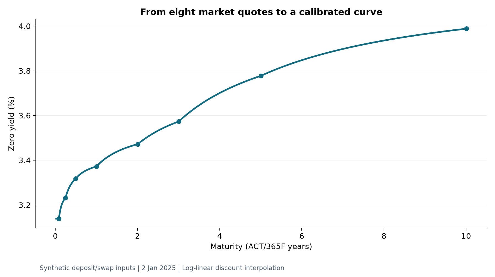
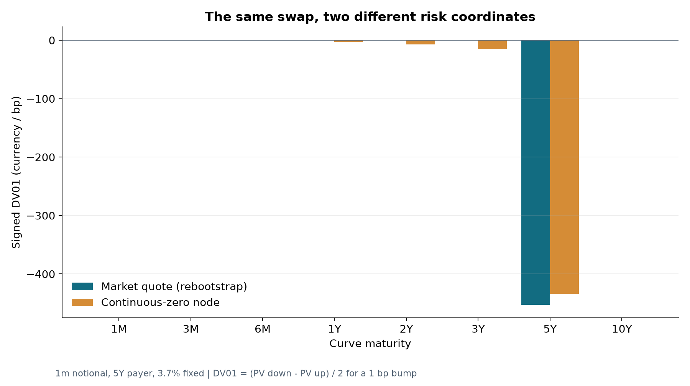

# rates-engine-cpp

[](https://github.com/Aniket2002/rates-engine-cpp/actions/workflows/ci.yml)
[](https://github.com/Aniket2002/rates-engine-cpp/releases/tag/v2.3.0)

A C++20 interest-rate pricing and risk engine with **OIS discounting, separately
calibrated projection curves and full-rebootstrap quote DV01**. Independent
Python and QuantLib implementations check calibration, cash flows and sensitivities.

- **Pricing:** fixed/floating swaps, seasoned SOFR swaps with realized fixings,
  observation conventions, and compounded overnight basis swaps.
- **Risk and hedging:** discount/projection quote sensitivities, shared portfolio
  scenarios, bounded hedge sizing and full-repricing stress analysis.
- **Lifecycle:** contractual payment reconciliation, cash-collateral ledgers and
  optional Python/SQLite journals with transaction and replay checks.

| Calibrated zero curve | DV01 ladder |
| --- | --- |
|  |  |

These plots show the introductory **single-curve, synthetic** example. Quote DV01
bumps market inputs and rebuilds the curve; zero-node DV01 shifts node yields.
[Inputs, outputs and reproduction](docs/worked-examples.md#build-and-price-one-swap)
and [chart provenance](docs/charts/manifest.json) are retained.

## Current release results

Recorded for **v2.3.0**, implementation commit `00519f48d767`, on 22 October 2026.
Each row names its configuration or suite; the counts are not interchangeable.

| Check | Recorded result | Evidence |
| --- | --- | --- |
| Windows Release CTest, Python bindings enabled | **100/100 passed** | [Runtime record](docs/results/runtime/verification.json) |
| Independent OIS / separate-projection validation | **230/230 comparisons passed**, QuantLib 1.44 | [Methods and tolerances](docs/multicurve.md), [report](docs/results/multicurve/report.json) |
| Release-commit CI | **7/7 jobs passed**: Linux, Windows, macOS, sanitizers, static analysis and coverage | [CI record](docs/results/ci-v2.3.0.json) |
| C++ library coverage, Linux Clang/LLVM 18 Debug | **92.50% lines / 80.13% branch outcomes** | [Scope and diagnostics](docs/coverage.md#current-release-v230) |

Coverage excludes CLI, bindings, Python code and dependencies. LLVM reported
31 functions with mismatched data; the linked report retains that warning.
[Historical measurements](docs/coverage.md#historical-measurements) use different
code and configurations. The badge above shows the current workflow status.

## OIS discounting and separate projection

The C++ and Python APIs bootstrap an OIS discount curve, then calibrate a
projection curve against forward-market quotes using that discount curve.
Discount-quote shocks rebuild discounting **and recalibrate projection to the
unchanged forwarding quotes**; projection-quote shocks hold discounting fixed.
QuantLib independently bootstraps from the same quotes and repeats the shocks.

Use `OisCurveBootstrapper`, `CurveBootstrapper::build_forward`,
`price(discount, projection, swap)` and `multi_curve_risk` for this workflow.
The [multi-curve guide](docs/multicurve.md) includes a C++ example and validation
details. [Seasoned SOFR](docs/sofr-lifecycle.md) and
[basis swaps](docs/basis-clearing-collateral.md) have dedicated APIs for their
observation conventions and curve dependencies. The CSV CLI remains a
single-curve introductory tool.

The examples use synthetic OIS/forward quotes. The SOFR fixing demonstration
combines captured NY Fed fixings with synthetic OIS quotes. Treasury curves are
used only in the separate [historical proxy study](docs/real-historical-data.md);
they are not an executable swap-market calibration. See the
[market-data policy](docs/market-data-status.md) and [model boundaries](docs/limitations.md).

## Build and validate

Requires CMake 3.25+, Ninja, a C++20 compiler and Python 3.10+. Install the
[build prerequisites](docs/reproducibility.md) first. GoogleTest is fetched on
the first test build. For the configured Windows environment:

```powershell
.\run.ps1 -WithPython -Test
.\.venv\Scripts\python.exe python/validate_multicurve.py --module-dir build/release --out results/multicurve --require-quantlib
```

On Linux/macOS, with the chosen Python environment active:

```sh
python -m pip install pybind11 QuantLib
cmake --preset release -DRATES_BUILD_PYTHON=ON -Dpybind11_DIR="$(python -m pybind11 --cmakedir)" -DPython3_EXECUTABLE="$(python -c 'import sys; print(sys.executable)')"
cmake --build --preset release --parallel 4
ctest --preset release
python python/validate_multicurve.py --module-dir build/release --out results/multicurve --require-quantlib
```

For a prebuilt CLI demonstration, extract the
[v2.3.0 Windows x64 ZIP](https://github.com/Aniket2002/rates-engine-cpp/releases/tag/v2.3.0),
open PowerShell in its root and run:

```powershell
.\bin\rates_cli.exe --quotes examples/synthetic_quotes.csv --swap examples/sample_swap.csv --out results/demo
```

Default Windows executables embed compiler runtimes. The ZIP includes native
tools and a static library; Python workflows require bindings built for the
chosen interpreter. [Public-download and extracted-ZIP verification](docs/results/runtime/release-verification.json)
records the checksum and system-only `PATH` checks.

## Follow pricing through to a hedge

The [SOFR hedging study](docs/hedging-study.md) sizes a bounded, lot-rounded hedge
and measures residual quote DV01 and full-repricing shocks. Its
[risk and scenario chart](docs/charts/hedging.png) shows both improvements and
shocks that worsen. It uses synthetic prices and assumed entry costs;
reducing the chosen sensitivity norm does not establish trading returns or
general market-risk reduction.

```sh
python python/hedge_study.py --module-dir build/release --out results/hedging --require-quantlib
```

Portfolio benchmarks demonstrate the **design choice of sharing calibrated
scenarios across trades** versus rebuilding them independently. They do not
benchmark against QuantLib. Workload definitions, absolute timings and machine
details are in the [scenario-reuse study](docs/v2.md#linux-replay-and-profiling-evidence).

## Documentation

| Topic | Guide |
| --- | --- |
| Valuations, cash flows and stress examples | [Worked examples](docs/worked-examples.md) |
| Risk signs, coordinates and conventions | [Risk methodology](docs/risk_methodology.md), [conventions](docs/conventions.md) |
| Contractual payments and durable journals | [Lifecycle guide](docs/durable-lifecycle.md) |
| Design, C++ consumers and implementation | [Architecture](docs/architecture.md), [consumer example](examples/consumer), [walkthrough](docs/implementation-walkthrough.md) |
| Performance experiments and historical results | [Benchmark methodology](docs/benchmarks.md), [portfolio study](docs/v2.md) |
| Release history and scope | [Release notes](docs/release-notes-v2.3.0.md), [development history](docs/development-history.md), [limitations](docs/limitations.md) |

MIT licensed; dependencies retain their own licenses. This is a deterministic
swaps project with explicit model boundaries and reproducible validation.
