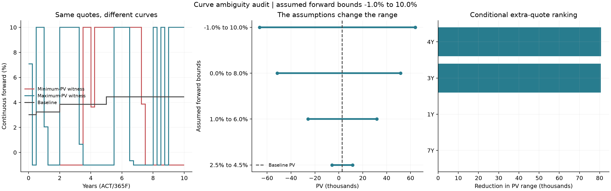

# rates-engine-cpp

[](https://github.com/Aniket2002/rates-engine-cpp/actions/workflows/ci.yml)
[](https://github.com/Aniket2002/rates-engine-cpp/releases/tag/v2.3.0)

A C++20 rates engine and **curve-risk research lab**. Price swaps, rebuild curves
for market-quote risk, and investigate **what valuation uncertainty remains when
every market quote fits**. Independent Python and QuantLib implementations check
pricing and risk.

- **Pricing:** OIS discounting, separate projection curves, seasoned SOFR and
  compounded overnight basis swaps.
- **Risk:** full-rebootstrap quote DV01, shared portfolio scenarios, bounded hedge
  sizing and full-repricing stress analysis.
- **Lifecycle:** contractual payment reconciliation, cash-collateral ledgers and
  optional Python/SQLite journals with transaction and replay checks.

**Version status:** this source targets **2.4.0-dev (unreleased)**. The latest
published download is **v2.3.0**. Curve ambiguity and the newer solver are source
features added after that release. See the [changelog](CHANGELOG.md).

## Quick start

To try pricing without a compiler, extract the
[v2.3.0 Windows x64 ZIP](https://github.com/Aniket2002/rates-engine-cpp/releases/tag/v2.3.0)
and open PowerShell in its root:

```powershell
.\bin\rates_cli.exe --quotes examples/synthetic_quotes.csv --swap examples/sample_swap.csv --out results/demo
```

Expected results for this **synthetic single-curve** example:

| Result | Approximate value |
| --- | ---: |
| Payer PV | 4,531.35 |
| Par fixed rate | 3.80% |
| Signed parallel quote DV01 | -451.94 per bp |

The output directory contains summary, curve, calibration, cash-flow and risk
CSVs. [Worked example and units](docs/worked-examples.md#build-and-price-one-swap)
explain the results. Windows compiler runtimes are embedded in the release ZIP;
Python workflows require bindings built for your interpreter.

For the current source, install CMake 3.25+, Ninja, a C++20 compiler and Python
3.10+, then follow the [build prerequisites](docs/reproducibility.md). In a
configured Windows checkout:

```powershell
.\run.ps1 -WithPython -Test
```

Linux/macOS and fresh Windows setup commands are in
[build and test instructions](CONTRIBUTING.md#build-and-test). GoogleTest is
fetched on the first test build. Python-enabled tests require pybind11, QuantLib
and SciPy; Matplotlib is only needed for charts.

## Curve ambiguity audit

**Available in current source; absent from the v2.3.0 download.**

The experiment finds minimum/maximum portfolio PVs compatible with quote
intervals and explicit forward-rate bounds. It exports the curves that attain
them, checks numerical LP optimality conditions, reprices with QuantLib, and
ranks hypothetical additional quotes by how much they narrow the range.

In the synthetic 1 million, 3.5Y payer example, **quote DV01 can be hedged below
1e-6 currency/bp while the same-quote valuation range remains unchanged**:

| Assumed continuous forward bounds | Minimum PV | Maximum PV |
| --- | ---: | ---: |
| -1% to 10% | -66,244.31 | 63,956.10 |
| 2.5% to 4.5% | -5,776.30 | 11,559.45 |

The ordinary bootstrap PV is **2,720.35**. These are attainable ranges under
stated assumptions, not confidence intervals or market forecasts.



[Research, prior art and reproduction](docs/curve-ambiguity-research.md) ·
[Inputs](examples/curve-ambiguity.json) ·
[Witnesses and numerical evidence](docs/results/curve-ambiguity/report.json)

Admissible curve bounds have established prior art. This project's contribution
is an auditable experiment combining valuation ambiguity, a quote-neutral hedge
counterexample and conditional quote prioritization. **No new mathematical
theory or global novelty is claimed.** The native API also supports discount
uncertainty with a separate projection curve held fixed.

## SOFR pricing and hedging

The captured example values a **USD 1 million payer, 3.75% fixed**, from
1 October 2026 to 1 October 2028, as of **21 October 2026, 18:17:09 UTC**:

| Seasoned SOFR valuation | Result |
| --- | ---: |
| Dirty PV | -4,448.43 USD |
| Signed accrued | 144.94 USD |
| Clean PV | -4,593.36 USD |
| Daily observations | 15 realized / 484 projected |

Captured NY Fed fixings are combined with **synthetic OIS quotes**.
[Inputs and reproduction](docs/worked-examples.md#seasoned-sofr-swap) retain the
observation conventions and valuation date; [SOFR validation](docs/sofr-validation.md)
documents comparisons and acceptance tolerances.

The [hedging study](docs/hedging-study.md) sizes a bounded, lot-rounded hedge and
measures residual quote DV01 and nonlinear shocks, including shocks that worsen.
It uses synthetic prices and assumed entry costs; reducing the chosen
sensitivity norm does not establish trading returns.

## Validation evidence

The badge shows current main-branch CI. The records below describe specific
historical revisions, not certification of unreleased changes.

| Scope | Recorded result | Evidence |
| --- | --- | --- |
| Published v2.3.0 Windows Release, bindings enabled | 100/100 CTest entries passed | [Runtime record](docs/results/runtime/verification.json) |
| Published release commit, cross-platform CI | 7/7 jobs passed | [CI record](docs/results/ci-v2.3.0.json) |
| Curve ambiguity implementation, Windows Release and Debug | 113/113 CTest entries passed in each configuration | [Revision, hashes and validation](docs/results/curve-ambiguity/verification.json) |
| Expanded ambiguity audit, 2.4.0-dev | 28 witnesses repriced; 154 QuantLib comparisons passed, including all sweeps | [Consistency verification](docs/results/curve-ambiguity/consistency-verification.json) |
| Independent OIS / separate-projection validation | 230/230 comparisons passed, QuantLib 1.44 | [Methods](docs/multicurve.md), [report](docs/results/multicurve/report.json) |

[Coverage](docs/coverage.md) records release-specific totals, the basis coverage
gap and LLVM profile warnings. CLI, bindings and Python code are outside that
library coverage denominator. [Benchmark studies](docs/README.md#validation-and-research-evidence)
state their workloads and machines; no QuantLib performance comparison is claimed.

## Documentation and scope

[Documentation index](docs/README.md) · [Worked examples](docs/worked-examples.md) ·
[Architecture](docs/architecture.md) · [Contributing](CONTRIBUTING.md) ·
[Changelog](CHANGELOG.md)

The CSV CLI is an introductory single-curve tool. Use the
[multi-curve APIs](docs/multicurve.md) for OIS discounting and separate projection;
discount-quote shocks rebuild discounting and recalibrate projection to unchanged
forwarding quotes. [SOFR](docs/sofr-lifecycle.md),
[basis swaps](docs/basis-clearing-collateral.md) and
[durable lifecycle](docs/durable-lifecycle.md) have dedicated guides.

Examples use synthetic curve quotes. Treasury curves support a separate
[historical proxy study](docs/real-historical-data.md), not executable swap-market
calibration. See [market-data status](docs/market-data-status.md) and
[model boundaries](docs/limitations.md). This is a deterministic quantitative
engineering project; production readiness, stochastic pricing and XVA are outside
its claims.

MIT licensed; dependencies retain their own licenses.
