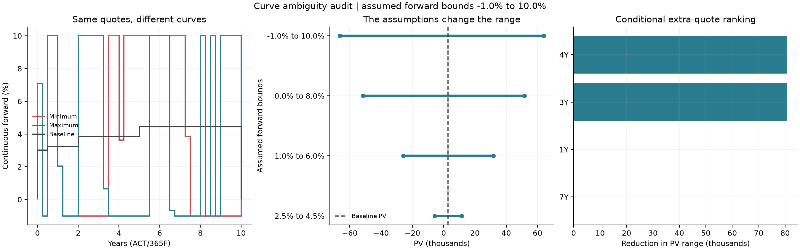

# Curve ambiguity: what the quotes do not identify

This experiment asks **how much a portfolio's PV can vary while every calibration
quote still fits**, and which additional quote would reduce that range. It uses
the existing C++ cash-flow engine, a linear optimization adapter, exported curves
and independent QuantLib repricing. It is a focused research extension to the
curve/risk core, not a claim of a new pricing theory or production readiness.

## Research and prior art

Research reviewed on 28 October 2026 covered curve interpolation, calibration
derivatives, admissible term structures, robust hedging, and open-source risk
engines. Search terms included “yield curve bid ask uncertainty”, “discount
factors linear programming”, “admissible term structures”, “curve calibration
Jacobian”, and “yield curve optimal experimental design”. This is a targeted
literature/software review, not an exhaustive novelty or patent search.

| Primary source | Established work | Consequence for this project |
| --- | --- | --- |
| [Hagan & West, *Interpolation Methods for Curve Construction* (2006)](https://bank.uni-hohenheim.de/uploads/media/Hagan_and_West__2006__-_Interpolation_Methods_for_Curve_Construction.pdf) | Interpolation choices affect forwards and hedge behaviour. | A different interpolation method alone is not a novel contribution. |
| [Cousin & Niang, *On the range of admissible term-structures* (2014)](https://arxiv.org/abs/1404.0340) | Quote-compatible term structures and bounds on discount/survival quantities; examples include OIS. | **Closest prior art:** admissible curve ranges are an established idea. |
| [OpenGamma, curve calibration and bucketed PV01](https://opengamma.com/strata-and-multi-curve-calibration-and-bucketed-pv01/) | Calibration Jacobians and algorithmic differentiation for quote sensitivities. | Faster sensitivities would be useful engineering, not original research by themselves. |
| [FinanceModels.jl, sensitivities through calibration](https://docs.juliaactuary.org/FinanceModels/dev/calibration_sensitivities/) | Implicit differentiation through supported calibrations. | An implicit-Jacobian feature would overlap existing public tools. |
| [Rateslib, getting started](https://rateslib.com/py/en/1.7.x/i_get_started.html) | Broad fixed-income instrument coverage, curve construction and automatic differentiation. | Expanding the product list offers little differentiation here. |
| [Open Source Risk, XVA risk example](https://github.com/OpenSourceRisk/Engine/blob/master/Examples/XvaRisk/Readme.md) | Scenario-based risk across markets. | Generic stress scenarios already exist. |
| [QuantLib discount curve implementation](https://github.com/lballabio/QuantLib/blob/master/ql/termstructures/yield/discountcurve.hpp) | Log-linear discount interpolation. | Used as an independent witness-pricing implementation. |
| [SciPy/HiGHS linear programming interface](https://docs.scipy.org/doc/scipy/reference/optimize.linprog-highs.html) | Linear optimization with primal results and dual marginals. | The optimizer is an existing dependency, not an algorithm invented here. |

The contribution here is the **reproducible combination** of cash-flow-exact
constraints, portfolio-specific extrema, inspectable primal/dual results,
independent repricing, a quote-neutral hedge counterexample and conditional
quote prioritization. No claim is made that this combination is globally unique.
The research question is useful even when the mathematical ingredients are known.

## Recorded experiment

The [input](../examples/curve-ambiguity.json) is deliberately synthetic: valuation
2 January 2025; a 1 million, 3.4% fixed payer ending 2 July 2028; exact quotes at
6M, 2Y, 5Y and 10Y. Default engine conventions apply. The first run assumes
continuous ACT/365F forwards between **−1% and 10%**, with no smoothness penalty.
The [full report](results/curve-ambiguity/report.json) retains input data, grid,
constraints, dual weights, witness curves, quote repricing and package versions.

| Result | Currency / stated units |
| --- | ---: |
| Ordinary log-linear bootstrap PV | 2,720.35 |
| Minimum attainable PV | −66,244.31 |
| Maximum attainable PV | 63,956.10 |
| Range width | 130,200.41 |
| Quote DV01 norm before par hedges, currency/bp | 251.9464 |
| Quote DV01 norm after par hedges, currency/bp | less than 1e-6 |
| Range width after those hedges | 130,200.41 |

The last two rows expose a specific blind spot: hedging the quoted risk factors
does not identify the discount factors between the quoted instruments. The
frictionless hedge solves a small linear system using four par swaps, including
a single-fixed-coupon swap matching the deposit endpoint. Every hedge has zero
PV on every exact-fit curve (within numerical tolerance), so the same-quote PV
range survives. This is a static incomplete-information example, not evidence
that DV01 hedging is generally ineffective or a claim about realized hedge P&L.



The extreme curves are intentionally jagged. They reveal the freedom permitted
by the assumptions; they are not estimated market forecasts. The broad initial
range must be read alongside the forward-bound ablation:

| Assumed continuous forward range | Minimum PV | Maximum PV | Width |
| --- | ---: | ---: | ---: |
| −1% to 10% | −66,244.31 | 63,956.10 | 130,200.41 |
| 0% to 8% | −51,628.14 | 51,660.17 | 103,288.31 |
| 1% to 6% | −25,738.53 | 31,720.80 | 57,459.33 |
| 2.5% to 4.5% | −5,776.30 | 11,559.45 | 17,335.75 |

Adding a hypothetical 4Y quote at the baseline model's par rate, with a ±0.5 bp
band, reduces the original width by **80,757.32**, to **49,443.09**. A 3Y quote
reduces it by 80,600.32; 1Y and 7Y add little for this target. These rankings are
**conditional on the assumed quote value and spread**. They are not expected
information gain, live quote availability, trading advice, or evidence that 4Y
is universally the best tenor. Each candidate is tested separately, not jointly.
The input-spread sweep independently widens the original quotes by 0–2 bp.

## Mathematical construction

Let the sorted grid contain valuation, every quote date, and all relevant
fixed/floating cash-flow dates. Its unknowns are discounts `D_i`, with `D_0=1`.
For each adjacent interval of ACT/365F length `dt`, explicit forward assumptions
`l <= f <= u` give linear inequalities:

```text
exp(-u * dt) D_(i-1) <= D_i <= exp(-l * dt) D_(i-1).
```

Starting from `D_0=1`, finite bounds keep all discounts positive and bounded.
Negative forwards are allowed; a discount greater than one is not rejected.
Interpolating log discounts between adjacent dates constructs a continuous
discount curve whose piecewise constant forward respects the same bounds.
Any curve with forwards in these bounds has grid discounts satisfying these
inequalities, so the grid does not lose relevant cash-flow information.

For an unseasoned, single-curve swap with no payment lag, each floating coupon's
PV is `D(start)-D(end)`. The C++ implementation sums these cash flows and the
fixed-leg accruals from `PreparedSwap`. Define the unit-notional floating PV as
`F(D)` and positive fixed annuity as `A(D)`. A par-quote interval becomes:

```text
bid * A(D) <= F(D) <= ask * A(D).
```

Both sides are linear in discounts, including when rates are negative. Deposits
give `1/(1+ask*tau) <= D(T) <= 1/(1+bid*tau)` with positive denominators;
continuous zero quotes give `exp(-ask*t) <= D(T) <= exp(-bid*t)`.
The constraint API permits quotes to share a maturity if labels differ;
inconsistent constraints are reported as infeasible. The JSON study's baseline
bootstrap requires distinct quote pillars. Quote mids are used for the baseline only.

A portfolio PV is a linear objective `c dot D`. Two LPs minimize/maximize it on
this set. All grid dates used in valuation have explicit discount variables,
so this does not sample a few named interpolators or approximate the objective
by DV01. It optimizes over the stated set directly. The mathematical extrema
are attainable; the computed results satisfy the numerical checks below.

The native API also accepts an optional **fixed projection curve** for target
swaps. Projected coupon amounts then become constants multiplying unknown
discounts. Quote constraints continue to describe the single discount curve;
projection is not recalibrated or optimized. This is conditional discount-curve
uncertainty, **not joint discount/projection uncertainty**. The recorded CLI
experiment uses same-curve targets, and explicitly does not extend the seasoned
SOFR or basis models to an LP.

## Numerical audit and validation

`src/curve_ambiguity.cpp` builds optimizer-independent constraints; SciPy's
HiGHS dual simplex solves them in `python/curve_ambiguity.py`. The objective is
scaled by its largest absolute coefficient (at least one). A result is accepted
only after checking:

- Every original inequality and the `D_0=1` anchor to 1e-9 absolute units;
  finite, strictly positive discounts; C++ witness construction.
- Scaled dual stationarity to 1e-9, nonpositive inequality duals to 1e-10, and
  primal/dual objective agreement within `1e-6 + scale*1e-10` currency.
- Original quote repricing inside its interval to 1e-9 decimal rate, and native
  portfolio repricing against the LP objective to 2e-6 currency.
- Independent QuantLib witness cash-flow PVs to 2e-7 currency per trade and
  quote repricing agreement to 1e-10 decimal rate. QuantLib receives the witness
  discounts: this validates pricing, **not an independent optimization**.

The report exports dual multipliers and scaling so the base LP's optimality
conditions can be recomputed. These are floating-point numerical audits, not
formal interval-arithmetic certificates. Infeasible or failed solves raise an
error and do not write a successful report. The baseline must satisfy the
assumptions too. Alternate optimal witnesses may differ across solver versions
while objective values remain the same.

Tests include closed-form interior-discount extrema in positive, negative and
zero-rate cases; exact identification of a quoted swap; nonidentification of an
intermediate swap; conflicting quotes; impossible forward bounds; deposit
intervals; payer/receiver symmetry; portfolio netting; forward-starting targets;
fixed separate projection; and reconstruction of dual stationarity and bounds.
The recorded study also verifies candidate-range nesting and hedge neutrality.
The [verification record](results/curve-ambiguity/verification.json) retains
test results and file hashes. Existing release coverage percentages do not
measure this new code.

## Reproduce and extend

Build current `main` with Python bindings; the v2.3.0 binary predates this feature.
Install the optional experiment dependencies in that same Python environment:

```sh
python -m pip install -r python/requirements-ambiguity.txt
python python/test_curve_ambiguity.py --module-dir build/release
python python/curve_ambiguity.py --module-dir build/release --input examples/curve-ambiguity.json --out results/curve-ambiguity --require-quantlib --plot
```

On Windows use `.venv\Scripts\python.exe`. Matplotlib is needed only for `--plot`;
SciPy is required for the Python-enabled test suite. Native C++ consumers can
use the exported constraint model with another LP solver without either package.
The JSON runner uses default vanilla conventions. The C++/binding API accepts
explicit quote conventions and a portfolio whose trades carry their own.

Useful research extensions would test actual timestamped executable quote
bands, alternative forward bounds, and conditional quote rankings across many
portfolios. Jointly uncertain projection curves need a different formulation.
The current dense LP is a small research implementation, not a large-book
scaling claim. No speed advantage over QuantLib, new theorem, stochastic model,
probability coverage, smoothness guarantee or production deployment is claimed.
