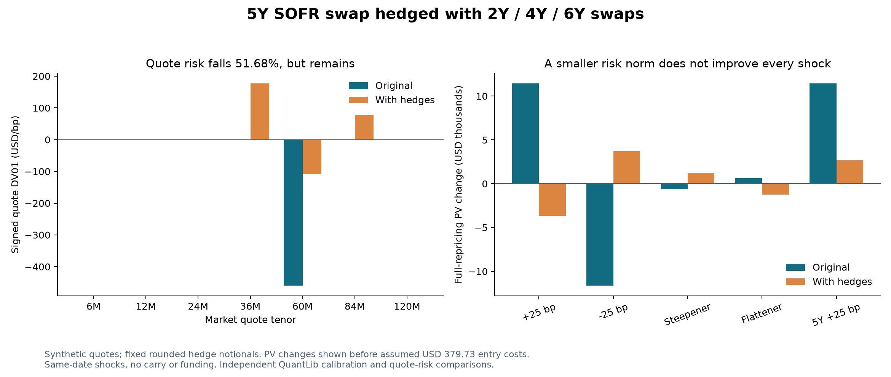

# SOFR hedging and residual-risk study

This is a hypothetical same-date risk-management exercise with synthetic quotes.
It is not a trading strategy backtest or an executable-market demonstration.

The portfolio pays 3.75% on a USD 1 million spot-starting five-year SOFR swap on
2 January 2025. Annual payments use ACT/360, two business days of spot settlement
and payment lag, weekend calendars and no end-of-month preservation. One
log-discount curve supplies projection and discounting. The market has seven
quotes from six months to ten years. All inputs and their SHA-256 hash are in
[report.json](results/hedging/report.json).

The hedge universe contains par 2Y, 4Y and 6Y swaps. A five-year hedge is excluded
deliberately: cancelling the original trade would not illustrate residual risk.
The signed position is measured in units of USD 1 million payer notional.

## Sizing and costs

For original quote-DV01 vector `b` and hedge columns `H`, minimize
`sum((b + H*x)^2)` subject to `-1.5 <= x_i <= 1.5`. All quote buckets have equal
weight; this is not a historical covariance or expected-shortfall objective.
The small solver enumerates every box face and solves its stationary equations
with pivoting. Singular hedge universes fail explicitly. Hand-solvable tests
cover exact hedging, binding limits and correlated exposures.

Round the solution to USD 1,000 notional lots and recompute exposures. This is a
continuous optimum followed by rounding, not a discrete optimum. There is no
gross-notional, funding, margin, liquidity or transaction-cost constraint.

| Hedge | Signed payer notional | Par fixed coupon | Assumed entry cost |
| --- | ---: | ---: | ---: |
| 2Y | -10,000 | 3.650000% | 25.96 USD |
| 4Y | -1,272,000 | 3.456140% | 261.55 USD |
| 6Y | -249,000 | 3.370830% | 92.22 USD |

Negative payer notionals are receiver positions. Hedge mid PV is zero to
numerical tolerance. Each nonzero hedge costs an assumed 0.5 bp half-spread
times its fixed-leg annuity, plus USD 25. Total entry cost is USD 379.73. The
scenario report deducts this once from the hedged PV change; it does not count
it again in the coupon. Costs are modeled inception costs, not actual fills.

## Results and interpretation

The quote-DV01 norm falls from 459.62 to 222.11 USD/bp (51.68%). Parallel signed
DV01 moves from -461.89 to +147.58 USD/bp: the hedge reverses and reduces that
exposure, but does not neutralize it. These are **market-quote key rates**;
zero-node risk is a different coordinate and is not substituted for quote risk.

| Shock | Unhedged PV change | Hedged PV change before entry costs |
| --- | ---: | ---: |
| Parallel +25 bp | +11,464.57 | -3,672.89 |
| Parallel -25 bp | -11,630.92 | +3,706.47 |
| Steepener | -639.49 | +1,239.08 |
| Flattener | +636.56 | -1,233.23 |
| Isolated 5Y +25 bp | +11,448.48 | +2,659.77 |
| Parallel +200 bp | +87,286.91 | -28,472.63 |
| Parallel -400 bp | -208,136.00 | +63,593.61 |

The flattener is an adverse counterexample: its loss increases. An unweighted
bucket-norm objective does not guarantee improvement for every correlated shock.
Large shocks expose nonlinear residuals: at -400 bp the hedged first-order error
is about USD 4,559.74. A tighter parallel constraint, alternative hedge universe
or covariance-weighted objective would produce different compromises.



`DV01 = (PV_down - PV_up)/(2*bump_bps)`, so the linear estimate is
`-sum(DV01_i * shock_bps_i)`. Curves are fully rebuilt for every scenario; the
same fixed hedge notionals and coupons are retained. No time passes, and carry,
rebalancing, financing, margin and changing spreads are excluded.

## Reproduce and validate

```powershell
.\run.ps1 -WithPython -Test
.\.venv\Scripts\python.exe python/hedge_study.py --module-dir build/release --out results/hedging --require-quantlib
```

Outputs include JSON provenance and CSVs for notionals, buckets, scenarios and
bump convergence. QuantLib independently calibrates OIS helpers and compares
44 base/scenario instrument PVs plus 28 quote sensitivities. The required mode
fails if QuantLib is absent or comparisons exceed USD 0.00002 (or USD/bp for
risk). Every stress curve must reprice quotes and retain finite positive factors.
Parallel risk is checked at 0.1, 0.5, 1 and 2 bp bumps.
The optional chart can be regenerated with `python python/generate_hedge_chart.py`
after installing matplotlib; PNG/SVG files include a source-hash manifest.

Existing SOFR validation separately covers leap dates, short final stubs,
holiday/payment calendars, alternative day counts, lookback, observation shift,
lockout and two-curve recalibration. This study expands stress evidence; it does
not add unsupported front/long-stub conventions or stochastic models.
