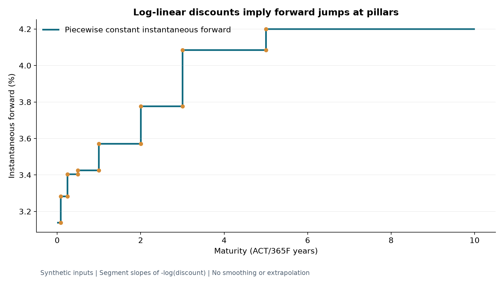

# Mathematics and calibration

All quotes and coupons are decimal rates: 3.7% is `0.037`. One basis point is
`0.0001`. Let valuation be date 0, `P(0,t)` a strictly positive discount factor,
`N` positive notional, `K` the fixed coupon, and `T_i` adjusted payment dates.
Times used by the curve are Actual/365 Fixed, while coupon accruals use each
leg's own day count. These two concepts must not be interchanged.

## Deposits and rate conversions

A valuation-date deposit exchanges one unit at inception for `1+r*tau` at
maturity. Setting its PV to zero gives

```
P(0,T) = 1 / (1 + r*tau),    1+r*tau > 0.
z(T) = -log(P(0,T)) / T,     T > 0 (continuous zero rate).
P(0,T) = exp(-z(T)*T).
```

The deposit `tau` uses Actual/360 by default. `T` in the zero-rate formula uses
Actual/365F. The zero rate at time zero is undefined and the API rejects it;
the discount factor there is exactly one. Negative rates and increasing
discount factors are valid. Positivity alone does not guarantee that any
arbitrary quote set is economically plausible.

## Interpolation

Between strictly increasing pillars `t_a <= t <= t_b`, with `w=(t-t_a)/(t_b-t_a)`:

```
log P(0,t) = (1-w)*log P(0,t_a) + w*log P(0,t_b).
f_segment = -(log P(0,t_b)-log P(0,t_a))/(t_b-t_a).
```

This gives piecewise constant instantaneous forward rates and continuous
discount factors; instantaneous forwards may jump at pillars. It does not
impose monotonic discount factors. There is no extrapolation policy in v1:
lookups before valuation or beyond the last pillar throw. Diagnostics show
pillar discount, continuous zero rate and segment forward rate.



The plot uses the [recorded synthetic curve](results/demo/curve.csv); each
horizontal segment is the slope of `-log P` between adjacent pillars. Vertical
connectors mark jumps, not intermediate forward values. The
[chart script](../python/generate_charts.py) and [input hashes](charts/manifest.json)
make it reproducible.

## Cash flows and swap value

For a forward-looking floating coupon over `[S_i,T_i]`, paid at `T_i`,

```
F_i = (P(0,S_i)/P(0,T_i)-1) / beta_i
PV_fixed = N*K*sum_i(alpha_i*P(0,T_i))
PV_float = N*sum_i(beta_i*F_i*P(0,T_i))
PV_payer = PV_float - PV_fixed
PV_receiver = -PV_payer
```

`alpha_i` and `beta_i` are the respective fixed and floating accrual fractions.
Leg PVs and cash flows carry the coupon's economic sign; the side sign is only
applied when combining the two legs. There are no principal exchanges.

For contiguous floating accrual periods with no payment lag and a common
projection/discount curve, the floating sum telescopes:

```
PV_float = N * [P(0,T_start)-P(0,T_end)]
A = sum_i(alpha_i*P(0,T_i))
K_par = [P(0,T_start)-P(0,T_end)] / A.
```

The C++ implementation explicitly values every floating coupon. The independent
Python reference uses the telescoping relationship. This provides different
calculation paths for validation. The identities fail in general with payment
lags, historical fixings, spreads or distinct projection and discount curves.
Changing the fixed coupon by `delta` changes payer PV by `-N*A*delta`; receiver
PV changes with the opposite sign. Coupon PV01 magnitude is `N*A*0.0001`; it
must not be confused with recalibrated market-quote DV01.

## Bootstrap algorithm

Quotes start on valuation and are sorted by their **adjusted** maturity.
Duplicate adjusted maturities and duplicate labels are rejected. Deposits give
analytic pillar discounts. At each swap pillar solve for `x=log P(0,T)`:

```
g(x) = K_par(curve(existing pillars + [T,exp(x)])) - market_quote = 0.
```

Every objective evaluation uses the same log-linear curve type and pricer as
the final valuation. A private trial curve is constructed once per swap pillar;
only its final discount factor and cached log change during the solve. Existing
nodes, times and logs are reused. Coupon dates between existing and candidate
pillars therefore depend on the candidate discount; no pre-existing-coupon-pillar assumption is
made. A symmetric log-discount bracket starts at `[-0.25,0.25]` and expands up
to `[-50,50]`. Safeguarded secant steps retain the sign-changing bracket, falling
back to bisection after two steps that each fail to halve it, or when interpolation
rounds to an endpoint. Endpoint evaluations from bracket expansion are reused.
The solver checks finite objectives, iteration limits and the quote residual.
Even inside a bracket narrower than the interval tolerance, it evaluates a
representable interior candidate before declaring exhaustion; an exact root
there must not be rejected by the interval check.
Bracket expansion and solving both retain the instrument label on failure.
The deliberately bounded search domain can reject extreme mathematical solutions
outside it.

For these valuation-date, no-payment-lag single-curve swaps, write
`P_i = c_i * exp(w_i*x)` with `0 <= w_i <= 1` and `P_T = exp(x)`.
Then `A = sum(alpha_i*P_i) > 0`, `0 <= A' <= A`, and
`dK_par/dx = -[P_T*(A-A') + A']/A^2 < 0`: the par rate is strictly decreasing,
including at negative rates, so a bracketed root is unique. With an exogenous
discount curve, the fixed annuity is constant and each projected floating factor
has exponent `(w_start-w_end)*x <= 0`, with at least one strictly negative term;
the same uniqueness argument applies. These arguments rely on the stated vanilla
cash-flow assumptions, not arbitrary lagged or basis contracts. The generic root
solver needs continuity and a sign change, not global monotonicity; it does not
certify uniqueness for other objectives. The separate seasoned SOFR and basis
calibrators retain their bisection solver.

Defaults: decimal quote residual `1e-12`, log-discount interval tolerance
`1e-14`, maximum 200 iterations. A small interval alone is insufficient: if
the residual is still too large the solver fails. Each input quote is repriced
against the completed curve. Calibration returns residuals, iterations and
convergence status, or throws with instrument context. Failed solves never
produce a usable partial curve.

These tolerances are for rates, not currency PV. For example a quote residual
`1e-12` multiplied by a one-million notional and a 25-year annuity can produce
currency error around `2.5e-5`. Risk differences further amplify calibration
error for very small bumps. See [validation](mathematical_validation.md).

## Sources

The external comparison uses QuantLib's documented
[log-linear DiscountCurve](https://quantlib-python-docs.readthedocs.io/en/latest/termstructures/yield.html)
and [date conventions](https://quantlib-python-docs.readthedocs.io/en/latest/dates.html).
All implementation and independent reference calculations in this repository
are original project code; QuantLib is only an optional validation dependency.
