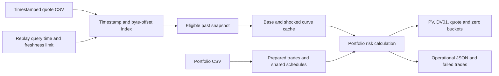

# Rates Engine v2 — historical replay and portfolio risk

Version 2 preserves the pricing equations and adds `PortfolioRiskEngine`,
`HistoricalQuoteStore`, `rates_batch` and `rates_portfolio_benchmark`.
The original v2 evidence below uses synthetic data. The later
[real historical data integration](real-historical-data.md) adds Fed Treasury
curves and a complete 2025 replay. This remains an engineering simulation.



## Portfolio calculations

`PortfolioRiskEngine` owns prepared trades. Trades with equal effective/maturity
dates and all calendar/day-count/frequency/adjustment conventions share immutable
fixed and floating schedules. Notional, coupon and side remain trade-specific.
`RiskScenarios` owns the base curve, parallel shocks, quote shocks and zero shocks.
For eight quotes it requires **19 calibrations per snapshot**, independent of
portfolio size, versus **1,900** for 100 independent full risk reports.
There are 35 curve valuations per trade (base + 2 parallel + 16 quote + 16 zero).
Zero-node shocks do not bootstrap. Both risk coordinates and PV use compensated
summation. Invalid trades appear in failures and do not enter any aggregate;
an overflowing aggregate fails the whole calculation.

The old single-trade API remains available. `PreparedSwap::with_economics`
reuses schedules safely, and const scenario/portfolio calculation has no global
mutable cache. A fresh snapshot, convention set or bump requires fresh scenarios.

## Timestamped history

The strict CSV header is
`timestamp,valuation_date,type,label,maturity,rate`. Timestamps are availability
times, in UTC with exact `YYYY-MM-DDTHH:MM:SSZ` syntax. Rows form chronological,
complete snapshots; labels must match the first snapshot, without duplicates.
Valuation date must equal observation UTC date. Startup validates the full file
and indexes only timestamps, byte offsets and row counts. An as-of query uses
binary search and reads just the latest snapshot at or before the query.
Lookup cost is O(log snapshots + quotes); index memory is O(snapshots).

Queries before the first observation fail. Age greater than the configured limit
fails; equality is accepted. A failed newer calibration never falls back to an
older successful curve. File changes detected by size/mtime invalidate the index.
Offline schema validation reads future records, but pricing receives only the
selected past snapshot. A regression test changes future quotes and verifies
unchanged earlier prices. This is not a concurrent mutable database or an
adversarial integrity protocol.

Repeated replay query times selecting the same observation reuse scenarios.
The example generator supplies four five-minute observations and forward-starting
swaps, avoiding missing historical fixings. That original example data is synthetic, generated
by repository code under the MIT license; no external market-data license applies.
As-of means valuation on the selected snapshot, not rolling its curve to query time.

## Reproducible performance

```sh
mkdir -p results
./build/release/rates_portfolio_benchmark results/scaling.csv 101 10000
python python/check_performance.py --benchmark build/release/rates_portfolio_benchmark --output results/regression.csv
# Optional gate on the same controlled machine/compiler and sample count:
python python/check_performance.py --benchmark build/release/rates_portfolio_benchmark --output results/current.csv --baseline results/regression.csv --max-slowdown 1.25
```

Each row includes mean, nearest-rank p50/p95/p99 microseconds, samples,
throughput (trades / mean full-risk time), compiler, configuration and platform.
One warm-up precedes timing. The maximum size is 100, 1,000 or 10,000 trades;
default is 10,000 with 21 samples. Use 101 or more samples for less coarse tails;
these observed quantiles still are not service latency guarantees.

| Workload | Timed boundary |
| --- | --- |
| cached | Portfolio risk with previously prepared trades and scenarios |
| uncached_schedules | Same scenarios; prepare each trade's schedules each call |
| end_to_end | Prepare scenarios and portfolio, then calculate full risk |
| independent | Rebuild scenarios and schedules per trade; limited to 100 trades |

The uncached baseline directly aggregates reports; the cached path additionally
retains trade results. This modest overhead is included rather than hidden.
End-to-end here means the in-process numerical calculation: file I/O, network,
queueing and output serialization are excluded. Schedule-build columns count
portfolio schedule pairs, excluding calibration-instrument schedules. Setup is
excluded from cached rows and included in end-to-end rows. Results are checked
for PV, parallel DV01 and all 16 buckets before timing; CTest runs the 100-trade
check. Deterministic cache/calibration counts are checked in C++ and Python.
Absolute timing gates are opt-in because shared CI runners are noisy.

The [operations workflow](../.github/workflows/operations.yml) records scaling on
Linux plus Callgrind CPU instruction profiles and Massif heap/allocation trees
for cached, uncached and independent modes. The modes include common process,
scenario and portfolio setup, one initial cached calculation, warm-up and one
measured invocation; they are whole-process profiles. Do not interpret instrumented
timings as normal latencies. Callgrind measures instructions, not hardware cycles.
Massif identifies live heap and allocating call sites, not every allocation's
latency. The workflow retains raw profiles, readable reports and CPU metadata.

## Validation and operation

The new GoogleTest and batch integration cases cover timestamp parsing, file
validation, freshness boundaries, no look-ahead, scenario reuse, 1,000-trade
linearity, schedule identity, partial failures and independent Python aggregate
risk. The earlier 2,193 convention comparisons and 1,285 default comparisons
remain in CI. See [coverage](coverage.md), [validation upgrade](validation-upgrade.md)
and the [runbook](../ops/runbook.md). Execution measurements are recorded separately
in `docs/results` so baseline and v2 evidence remain distinguishable.

## Windows measurements, 2026-10-17

The 101-sample Release run on an Intel Core i9-11900H, Windows AMD64,
LLVM-MinGW Clang 23.1.3 produced these full-risk calculation timings:

| Cached portfolio | p50 ms | p95 ms | p99 ms | Trades/second (mean) |
| --- | ---: | ---: | ---: | ---: |
| 100 trades | 7.817 | 8.277 | 9.298 | 12,664 |
| 1,000 trades | 76.915 | 81.713 | 83.021 | 13,245 |
| 10,000 trades | 771.944 | 875.590 | 906.037 | 12,930 |

At 100 trades, including scenario and portfolio preparation took **19.142 ms
p50**, versus **1,093.926 ms** for independent full reports: about **57.1x** on
this workload. Shared calibration is the primary improvement. Schedule caching
alone was small/noisy at 100 trades (7.817 vs 8.074 ms p50); it is not claimed to
deliver the large calibration speedup by itself.

[Raw Windows data](results/portfolio-scaling-windows.csv) includes all workloads.
The workstation was not isolated or frequency-locked; later samples overlapped
local build/test work, so tail and large-portfolio comparisons include background
load. These are observed in-process library measurements, not trading-system
latency or a guaranteed production throughput.

## Linux replay and profiling evidence

This is a design-choice experiment: shared calibrated scenarios versus independent
per-trade reports within this engine. The independent path repeats calibration
and setup for every trade; the shared path amortizes that work. The ratio below
measures that workload difference, not performance against QuantLib, an optimized
competing engine or a previous engine revision. QuantLib is used for numerical
validation, not as a timed baseline.

The [successful workflow run](https://github.com/Aniket2002/rates-engine-cpp/actions/runs/39026489883)
used revision `60195cf`, GNU 13.3.0, RelWithDebInfo and a four-vCPU AMD EPYC 7763
GitHub runner. Its 101-sample full-risk results were:

| Cached portfolio | p50 ms | p95 ms | p99 ms | Trades/second (mean) |
| --- | ---: | ---: | ---: | ---: |
| 100 trades | 6.335 | 6.510 | 7.392 | 15,704 |
| 1,000 trades | 63.244 | 63.645 | 64.952 | 15,787 |
| 10,000 trades | 632.367 | 634.068 | 635.625 | 15,806 |

Including scenario and portfolio setup, 100 trades took **14.715 ms p50**,
versus **835.954 ms** for independent reports, about **56.8x**. Schedule caching
alone reduced the 10,000-trade p50 from 648.586 to 632.367 ms, about 2.5%.
[Raw Linux timings](results/portfolio-scaling-linux.csv) and
[CPU environment](results/linux-cpu-environment.txt) are retained.

Whole-process Callgrind instruction counts were 268,056,636 cached,
271,612,206 uncached schedules and 17,000,522,754 independent. These include
common setup and are not an isolated per-call instruction count. Prepared swap
pricing accounted for 89.07% of inclusive instructions in the cached profile,
including bootstrap pricing. Remaining cash-flow vector construction appears
in the allocation/call trees and is a concrete candidate for later optimization.

Massif peak live heap was 163,448 bytes cached, 159,736 bytes uncached and
182,008 bytes independent. Cached schedules and retained portfolio results do
not imply lower live heap than immediate uncached aggregation. These numbers
include process/runtime allocations and exclude stack memory. The
[profile summary](results/linux-profile-summary.json) preserves the measurements;
raw profiles and readable allocation/CPU trees are available in the workflow's
`replay-performance-profiles` artifact.

The same run successfully replayed eight query times for 1,000 swaps, retaining
five schedule pairs and recalibrating only when the selected snapshot changed.
The [JSON event log](results/replay-linux.jsonl) records freshness, timings,
calibration reuse, PV and risk for each step. All eight steps priced every trade.
The later static-analysis fix makes integer conversions explicit and reserves
benchmark setup vectors; the recorded measurements identify their original revision.

## Final verification, 2026-10-18

Revision `f7dd4cf` passed [all seven main CI jobs](https://github.com/Aniket2002/rates-engine-cpp/actions/runs/39094645896):
GCC Release, Clang Debug, Windows MSVC, macOS, static analysis, LLVM coverage and
ASan/UBSan. Local Release passed all 50 CTest entries, including 44 GoogleTest
cases, independent pricing/convention validation, batch/replay integration,
bindings and the performance contract. The final local coverage build passed
48 entries and measured 98.92% line / 88.78% branch coverage for the library.
The [provenance file](results/v2-provenance.json) records the tested revision,
measurement revisions, toolchains and workflow links.
